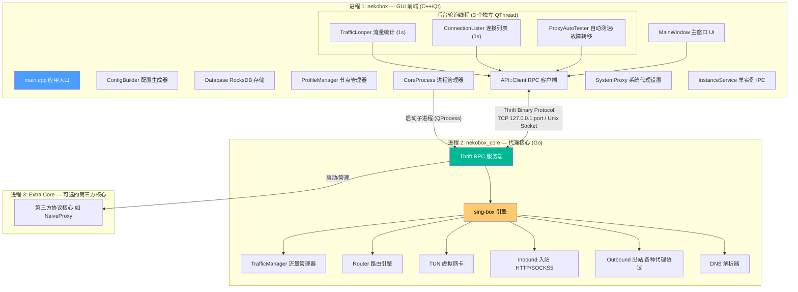
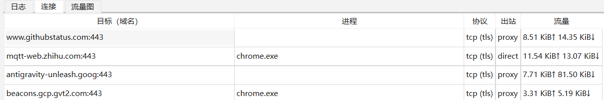

# nekobox 

[Nekobox](https://github.com/qr243vbi/nekobox) 是一个开源的代理客户端软件。

自从我的 v2rayN 不维护了导致一些 VLESS类型结点无法使用，就一直转战用的nekobox。

想说既然在用，不如了解学习一下他做了什么。

## 进程架构

1、客户端 GUI (C++/Qt)

2、后端 core 服务(Go)


## RPC 通信机制

客户端（C++/Qt）与后端（Go 核心进程）之间的所有请求均通过 **Apache Thrift** RPC 调用进行交互。

通过 Thrift 接口定义文件（IDL），编译系统使用 Thrift 编译器分别生成 C++ 客户端代码 (`gen-cpp/`) 和 Go 服务端代码 (`core/server/gen/`)。

### Thrift 的洋葱(封装)分层模型

在客户端发起一次远程调用前，需要自底向上组装调用栈。这种层层嵌套的构造方式是典型的**装饰器模式**：

```cpp
// 1. Transport 层：指定底层通信端点 (127.0.0.1:19810)
auto socket    = getThriftTransport(); 
// 2. Transport 缓冲层：加装内存 Buffer 提高 I/O 吞吐
auto transport = std::make_shared<TBufferedTransport>(socket); 
// 3. Protocol 协议层：确定数据编解码规则（二进制 Binary 格式）
auto protocol  = std::make_shared<TBinaryProtocol>(transport); 
// 4. Client 存根：上层业务代理，让远程调用体验如同本地函数
libcore::LibcoreServiceClient client(protocol);
```

| 层次 | 组件 | 职责 |
| :--- | :--- | :--- |
| **I/O 传输** | `TSocket` + `TBufferedTransport` | 维护底层 TCP 连接与读写缓冲 |
| **序列化** | `TBinaryProtocol` | 将内存对象与 Thrift 二进制流互转 |
| **业务代理** | `LibcoreServiceClient` | 对上暴露业务 RPC 接口（如 `ListConnections`） |

### 一次调用的完整生命周期

组装完成后，一次典型的 RPC 调用本质就是一次标准的网络 I/O 闭环：

```text
transport->open();                  // 1. 触发真实 connect()，完成 TCP 三次握手
client.ListConnections(resp, req);  // 2. 序列化请求 -> 发送数据 -> 阻塞等待 Core 返回并反序列化
transport->close();                 // 3. 触发 close()，完成 TCP 四次挥手
```

{}
在桌面轻量代理场景中，部分低频控制指令（如改配置）随用随连；而针对流量监控等高频轮询任务，则会在独立轮询线程中复用连接以避免频繁握手开销。
{}

### 典型 RPC 场景：连接与流量监控

GUI 上的网速悬浮窗、活动连接列表，本质都是前端通过定时轮询 RPC（如 `QueryStats`、`ListConnections`）从后端拉取数据并渲染的。



在上图的连接监控面板中，一个活跃连接被拆解出了极其丰富的维度。这些看似普通的字段，底层来源却大相径庭：

| 字段 | 底层来源 | 技术细节 |
| :--- | :--- | :--- |
| **`Network`** (TCP/UDP) | Socket 层 | 握手建立连接时即已知 |
| **`Destination`** (IP:Port) | 网络包元数据 | 系统代理模式由浏览器直接告知；TUN 模式从 IP 包头提取 |
| **`Domain`** (github.com) | **Sniffer 嗅探** / **Fake-IP** | 解析 TLS SNI 扩展名或查询 DNS 映射反查表 |
| **`Protocol`** (TLS/HTTP) | **Sniffer 嗅探** | 扫描流前导字节特征码（如 TLS 的 `0x16 0x03`） |
| **`Process`** (chrome.exe) | **操作系统内核 API** | Windows: `GetExtendedTcpTable` / Linux: `/proc/net/tcp` 查 inode 映射 PID |
| **`Outbound`** (节点名/Direct) | **路由引擎** | 规则集判决（GeoIP、域名后缀、进程黑白名单） |

查看 [server.go](https://github.com/qr243vbi/nekobox/blob/main/core/server/server.go) 的 `ListConnections()` 实现：

```go
func (s *server) ListConnections(...) {
    // 1. 通过依赖注入获取 sing-box 的 ClashAPI 服务
    clash := service.FromContext[adapter.ClashServer](internal.BoxInstance.Context()).(*clashapi.Server)

    // 2. 获取所有活跃连接并组装返回给 GUI 前端
    connections := clash.TrafficManager().Connections()
    for _, c := range connections {
        r := &gen.ConnectionMetaData{
            ID:       c.ID.String(),
            Upload:   c.Upload.Load(),
            Download: c.Download.Load(),
            Outbound: c.Outbound,            // 路由判决结果
            Network:  c.Metadata.Network,    // TCP / UDP
            Dest:     c.Metadata.Destination.String(),
            Protocol: c.Metadata.Protocol,   // 嗅探检测到的协议
            Domain:   c.Metadata.Domain,     // 嗅探提取出的域名
            Process:  process,               // 操作系统 API 查询到的进程名
        }
    }
}
```

从这里可以看出：**nekobox-core 本质上是对 [sing-box](https://github.com/sagernet/sing-box) 做了一层 Thrift RPC 封装，真正承担代理转发、规则路由与特征提取的核心工作均由 sing-box 完成。**   

---

## 深入内核：sing-box 是如何做流量嗅探的？

在上述字段中，最令人好奇的是 **`Domain`** 和 **`Protocol`**：在当今全站 HTTPS 加密的大环境下，代理核心在不解密用户流量的前提下，是怎么知道你访问了什么域名、用的是什么协议的？

### 1. 代理核心的数据流转拓扑

理解嗅探前，先厘清数据包在代理软件内部的经典流动路径：

```text
[ 本地浏览器 / 终端应用 ]
       │
       ▼ (Inbound 入站：通过本地代理端口或 TUN 虚拟网卡接收流量)
[ 代理核心 Core ] ───► 【 流量嗅探 (Sniffer) 】：偷看前几个字节，提取出域名与应用协议
       │
       ▼ (Router 路由判决：直连？走节点？还是广告拦截？)
[ Outbound 出站 ] ───► 发往对应远程代理节点或直连目标服务器
```

### 2. 嗅探的本质：只看不吃（PeekStream）

嗅探发生在**TCP 连接刚建立、首个数据包到达的瞬间**。

核心机制在于 **“Peek（偷看）而不 Read（消费）”**。在不把数据从 TCP 缓冲区真正读走的前提下，枚举已注册的各种协议嗅探器（TLS, HTTP, QUIC, BitTorrent 等）去匹配特征码：

```go
// 精简自 sing-box 的 PeekStream 核心逻辑
func PeekStream(ctx context.Context, metadata *adapter.InboundContext, conn net.Conn, sniffers ...StreamSniffer) error {
    // 1. 预读首包数据到临时缓冲区（只做试探性窥探，不影响后续正常转发）
    _, err := buffer.ReadOnceFrom(conn)
    if err != nil { return err }

    // 2. 依次枚举各种协议嗅探器套用特征
    for _, sniffer := range sniffers {
        reader := bytes.NewReader(buffer.Bytes())
        // 例如 TLS 嗅探器会检查前导字节是否为 0x16 0x03 (TLS Record Layer)
        // 并从握手报文中提取 ClientHello 里的 Server Name Indication (SNI 扩展名)
        if err := sniffer(ctx, metadata, reader); err == nil {
            return nil // 嗅探成功，Domain 与 Protocol 已写入 metadata
        }
    }
    return ErrNeedMoreData // 特征不足或无法识别
}
```

{}
虽然 TLS 会对后续数据传输进行高强度加密，但在最初的握手阶段，客户端必须通过未加密的 `ClientHello` 扩展中的 **SNI（Server Name Indication）** 告诉服务器目标域名，以便单台物理服务器返回正确的 SSL 证书。嗅探器正是利用了握手阶段的这一未加密窗口。
{}

---

## 总结

通读 nekobox 的代码，整个项目的工程架构展现了极强的克制与解耦思想：

1. **界面与核心彻底解耦**：C++/Qt 前端专注打造流畅的跨平台桌面 UI、托盘与网速图表；Go 后端专注于高并发网络 I/O 与规则调度。
2. **Thrift 作为高效胶水**：类型安全且跨语言的二进制 RPC，让 GUI 和核心进程可以独立演进，甚至方便替换不同的代理核心。
3. **善用现代网络基建**：借助 sing-box 的模块化设计，将连接跟踪、SNI 嗅探、内核级进程追溯等复杂系统能力开箱即用。

对的，AI rephrase 过了哈哈